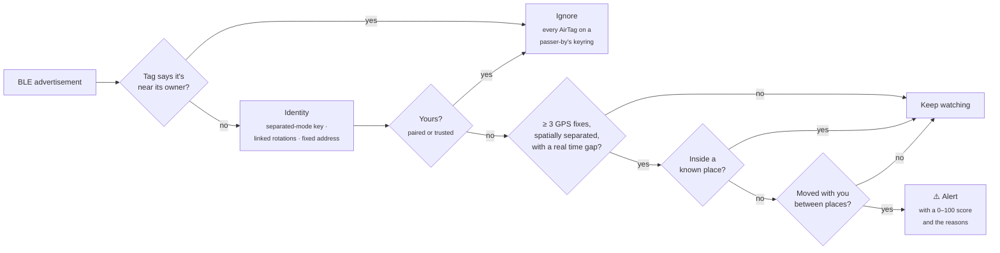

<p align="center">
  <picture>
    <source media="(prefers-color-scheme: dark)" srcset="docs/banner-dark.svg">
    <source media="(prefers-color-scheme: light)" srcset="docs/banner-light.svg">
    
  </picture>
</p>

<p align="center">
  <a href="https://github.com/aubergine-ux/ambit/actions/workflows/ci.yml"></a>
  <a href="LICENSE"></a>
  
  
  
  
</p>

<p align="center">
  <b>See what's broadcasting around you, and notice when something keeps following you.</b><br>
  Ambit logs Wi-Fi and Bluetooth broadcasts over time, names the manufacturer behind an address
  where it honestly can, and warns when a Bluetooth tracker turns up at place after place with you.
</p>

<p align="center">
  <a href="#-features">Features</a> ·
  <a href="#-how-tracker-detection-works">Tracker detection</a> ·
  <a href="#-what-ambit-is-not">Limits</a> ·
  <a href="#-build">Build</a> ·
  <a href="#-architecture">Architecture</a> ·
  <a href="#-roadmap">Roadmap</a>
</p>

---

> [!IMPORTANT]
> **Everything stays on your phone.** The manifest doesn't declare the `INTERNET` permission, so
> Android itself blocks Ambit from opening a socket. That's enforced by the platform, not just
> promised. There are no accounts, no analytics, no telemetry and no cloud.

## ✦ Features

<table>
<tr>
<td width="50%" valign="top">

### 📡 Passive observation
Wi-Fi access points and BLE advertisements are logged with signal strength, a timestamp and a
GPS fix. A foreground service keeps logging while the screen is off, so you can walk a building
with the phone in your pocket.

</td>
<td width="50%" valign="top">

### 🏷️ Honest vendor lookup
A bundled copy of the IEEE MA-L registry (about 40,000 assignments) names the manufacturer
behind real hardware addresses. Randomized BLE addresses are labeled *randomized*. Ambit
doesn't make up an "unknown device".

</td>
</tr>
<tr>
<td valign="top">

### 🛰️ Tracker correlation
Ambit reads each tag's own "away from owner" state and follows AirTags, SmartTags, Find Hub
tags, Tiles and Chipolos through their address rotations. It runs in the background with the
screen off, and alerts only after a tag has been seen at **three separate places**.

</td>
<td valign="top">

### 📤 Your data, your formats
Export to CSV (devices or raw sightings), versioned JSON, or a plain-text **environment debrief**
you can read, archive or paste wherever you like. Files leave the phone only when you share them.

</td>
</tr>
<tr>
<td valign="top">

### 🔎 Locate mode
A hot/cold finder for a flagged tracker: a large signal meter, vibration and beeps that speed
up as the signal gets stronger, and **Play sound** for AirTags, Find My accessories and Find
Hub tags, but only after you confirm. Offline guides cover what each tracker looks like,
where they're usually hidden, and how to switch one off safely.

</td>
<td valign="top">

### 🛡️ Built to stay quiet
Ambit only listens. Its single exception is Play sound, which opens a short Bluetooth
connection to the tracker and only runs after you confirm. Nothing ever goes over the
internet.

</td>
</tr>
<tr>
<td valign="top">

### 🚌 Wi-Fi that follows you
Phone hotspots, car Wi-Fi and portable cameras are flagged when the same access point turns up
at three places you go, using the same rules as Bluetooth trackers. The alert says plainly that
it's often just someone on the same bus.

</td>
<td valign="top">

### 📷 Possible cameras, nearby
Wi-Fi networks named like a camera or gadget in setup mode, hardware from camera makers, and
the Bluetooth IDs used by Meta and Luxottica camera glasses all get a note. There's also an
optional alert for glasses at close range. These are pattern matches, and the app labels them
that way.

</td>
</tr>
<tr>
<td valign="top">

### 🧭 Fewer false alarms
Your own paired headphones, watch and car never count. Tap **This is mine** to trust a tag,
and mark home or work as known places. A tag also has to *move with you* from place to place,
not just turn up where you happen to be twice. Every alert comes with a 0–100 score and a
plain-language list of why it was flagged.

</td>
<td valign="top">

### 🎯 A radar that admits it's decorative
Distance comes from log-distance path loss and means roughly *near / mid / far*. The angle is a
stable hash of the device's identity and carries no bearing information. If the radar and the
list ever disagree, trust the list.

</td>
</tr>
</table>

## ✦ Screens

| Screen | What it's for |
|---|---|
| **OPS** | Radar, live Wi-Fi readout, BLE controls and one-tap exports, all in one vertical scroll. Nothing is hidden behind a tab, because a tab is hard to reach on a dashboard mount. |
| **ALERTS** | Tracker verdicts, plus the evidence and method behind each one. |
| **LOCATE** | Hot/cold signal meter with vibration and beeps, plus Play sound on supported trackers. |
| **GUIDE** | Offline, per-family guide: what it looks like, where it hides, how to disable it safely. |
| **EXPORT** | Every export format, with a preview of the debrief. |
| **SETTINGS** | Scan interval, alert sounds, known places, data retention. |
| **Device detail** | Opens from any row: identity, RSSI trace over time, sighting history. |

## ✦ How tracker detection works

Tracker networks rotate their addresses so that strangers can't follow *the owner*. They also
tell the world whether the tag is with its owner, because that's how the networks themselves
warn about unwanted tracking. Ambit reads that state and keys on what each tag holds steady
while it's away from its owner:



| Family | Recognized by | Owner state | Identity while separated |
|---|---|---|---|
| Apple Find My | Manufacturer data `0x004C`, type `0x12` | Full-key form = separated | Public key, held ~24 h |
| Samsung SmartTag | Service data `0xFD5A` | State bits in byte 0 | Privacy ID, rotations stitched by aging counter |
| Google Find Hub | Service data `0xFEAA`, frame `0x40`/`0x41` | `0x41` = separated | Ephemeral ID, held ~24 h |
| Tile | Service `0xFEED` | Not advertised | Fixed address |
| Chipolo | Company `0x08C3`, service `0xFE33`/`0xFE65` | Not advertised | Fixed address |
| Pebblebee | Service `0xFA25` | Not advertised | Fixed address |
| Any DULT tracker | Service data `0xFCB2` (IETF draft) | Near-owner bit | Address, held while separated |
| Wi-Fi network | BSSID, from Wi-Fi scans | — | BSSID (real hardware) |

Beacons that don't match a known family are still correlated by address. A beacon that rotates
its address without saying how can't build up places, so it can't cause a false alarm.
Vendors change these formats between firmware generations, so treat a family label as a best
guess.

**Travelling together.** A move from one place to the next only counts if the tag was heard
shortly before you left and shortly after you arrived (within 2 hours on Standard). A
colleague's tag that you pass at the office, the canteen and the gym on separate trips
doesn't qualify.

**Sensitivity.** *Relaxed*, *Standard* and *High* change how far apart the places must be
(400 / 250 / 150 m), how long the trail must last (45 / 20 / 10 min), and, for Relaxed only,
require a fourth place. Every level needs at least three.

> [!NOTE]
> **Why three places?** One sighting is noise, and two is usually coincidence. The
> three-location threshold is a deliberate trade-off against false alarms, because an alert
> that cries wolf teaches you to ignore the one that matters. `TrackerCorrelatorTest` asserts
> the threshold so it can't be lowered quietly.

## ✦ What Ambit is not

> [!WARNING]
> Ambit only sees devices that are **actively broadcasting**. Please don't rely on it for more
> than that.

- ❌ It **can't** find a camera that records to an SD card without transmitting. Camera notes
  are pattern matches on network names, maker IDs and Bluetooth IDs, not detections.
- ❌ It **can't** identify people or vehicles.
- ❌ It **doesn't** intercept traffic. It reads advertisement and beacon metadata only.
- ❌ It **can't** give a bearing. A phone has one antenna and no direction finding. Locate
  mode shows signal strength only: *warmer* or *colder*, never "3 m to the left".
- ❌ It **can't** make every tracker beep. Tile, SmartTag and Chipolo's own network don't let
  other people make their tags beep, and any tag stays silent while it's near its owner.
- ❌ A vendor label describes the **manufacturer**, not the owner or the purpose. A "fleet"
  cellular router might belong to a food truck.

## ✦ Design constraints

These four constraints shaped the app.

<details>
<summary><b>Wi-Fi scan throttling</b></summary>

<br>

On Android 9+, `WifiManager.startScan()` is limited to four calls every two minutes, and
foreground apps aren't exempt. Ambit refreshes at that slow, real rate and shows the actual age
of the last scan. It never re-emits cached results with fresh timestamps to look faster. When
`getScanResults()` keeps returning the same frozen set, which is the sign of throttling, Ambit
points you to the *Wi-Fi scan throttling* switch in Developer Options.

</details>

<details>
<summary><b>MAC randomization</b></summary>

<br>

Most BLE devices rotate their address, so vendor lookup fails for most BLE hits. That's expected,
not a bug. Vendor classification mostly works for Wi-Fi, because access-point BSSIDs are real
hardware addresses. For BLE, a device's identity is its `TrackerSignature`, never its address.

</details>

<details>
<summary><b>The radar is decorative</b></summary>

<br>

The phone has one antenna, no phased array and no bearing information. Indoors, RSSI-based
distance is off by several meters. Each blip's angle is a hash of its identifier, so it stays put
between frames instead of jumping around, which would look like movement. No detection logic
ever reads a screen position.

</details>

<details>
<summary><b>Foreground service typing</b></summary>

<br>

Android 14+ needs declared foreground-service types that match granted runtime permissions,
and it kills the process at `startForeground()` if they don't match. Ambit declares `location`
and `connectedDevice`, and its start buttons stay disabled until the matching permission is
granted.

</details>

## ✦ Permissions

| Permission | Why |
|---|---|
| `ACCESS_FINE_LOCATION` / `COARSE` | Android returns **no** scan results without it. It also geotags sightings for the correlator. |
| `ACCESS_WIFI_STATE` / `CHANGE_WIFI_STATE` | Read and request Wi-Fi scans. |
| `BLUETOOTH_SCAN` / `BLUETOOTH_CONNECT` | Receive BLE advertisements. |
| `FOREGROUND_SERVICE_*` | Keep logging with the screen off. |
| `POST_NOTIFICATIONS` | The ongoing-session notification and tracker alerts. |

`BLUETOOTH_SCAN` is declared **without** `neverForLocation`. That flag would look better on a
privacy checklist, but it strips location out of BLE results, and location is what the correlator
runs on. The onboarding screen explains this in plain words.

## ✦ Build

Requirements: JDK 17+ and the Android SDK (API 36).

```bash
./gradlew assembleDebug     # → app/build/outputs/apk/debug/
./gradlew test              # JVM unit tests: correlator, signatures, OUI, path loss, exporters
./gradlew lint

adb install -r app/build/outputs/apk/debug/app-debug.apk
```

> [!TIP]
> **The emulator has no radios**, so every scan comes back empty there. Test on a real phone
> over wireless debugging (`adb pair` / `adb connect`) so you can walk around untethered while
> it logs.

<details>
<summary><b>Signed release builds</b></summary>

<br>

Release signing reads from a `keystore.properties` file in the project root. The file is
gitignored and never committed:

```properties
storeFile=app/release.jks
storePassword=…
keyAlias=…
keyPassword=…
```

or from the environment variables `AMBIT_STORE_FILE`, `AMBIT_STORE_PASSWORD`, `AMBIT_KEY_ALIAS`
and `AMBIT_KEY_PASSWORD`. If neither is present, `./gradlew assembleRelease` produces an
unsigned APK.

</details>

## ✦ Architecture

Kotlin · Jetpack Compose + Material 3 · Room · Hilt · DataStore · kotlinx-serialization ·
platform `LocationManager` (no Google Play Services, so it can ship on F-Droid).

```text
io.aubergine.ambit/
├── scan/        Wi-Fi + BLE scanners → one Flow<Observation>, foreground service
├── analysis/    OUI classifier, signature extraction, tracker correlator, path loss
├── data/        Room database (real migrations, no destructive fallback), repositories
├── export/      CSV, JSON and plain-text debrief
├── model/       Observation, Device, TrackerSignature, RadioType
├── ui/          OPS, alerts, detail, export, settings, onboarding, radar
└── util/        notifications and audio cues
```

- Composables only talk to the repository layer, never to DAOs or scanners directly.
- All timestamps are UTC epoch millis and are formatted only for display.
- Room migrations go back to the first schema, because people keep months of logs.

## ✦ Roadmap

- [x] Wi-Fi + BLE scanning, foreground service, Room persistence, OUI vendor names, CSV export
- [x] Radar, per-device detail and sighting history, JSON + debrief export, audio cues
- [x] Tracker correlator, alerts UI, known-place suppression
- [ ] F-Droid packaging and reproducible builds
- [ ] Translations via Weblate

## ✦ Contributing

Issues and pull requests are welcome. If you change the tracker correlator, add a test that
feeds it a synthetic sequence of sightings. It's the part of the app with real logic, and the
part most likely to regress silently. User-facing text goes in `strings.xml` so it can be
translated.

## ✦ License

[Apache License 2.0](LICENSE).

---

<p align="center">
  <sub>
    Vendor names from the public <a href="https://standards.ieee.org/products-programs/regauth/">IEEE MA-L registry</a> ·
    detection threshold inspired by <a href="https://github.com/seemoo-lab/AirGuard">AirGuard</a> research ·
    built with Kotlin and Jetpack Compose
  </sub>
  <br><br>
  <a href="https://github.com/aubergine-ux"></a>
</p>
