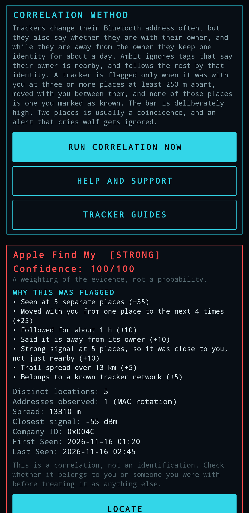
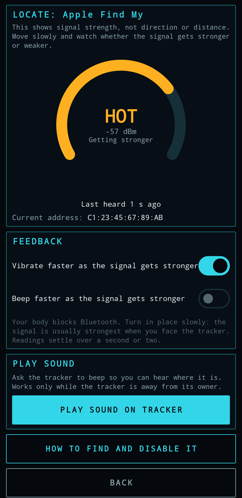
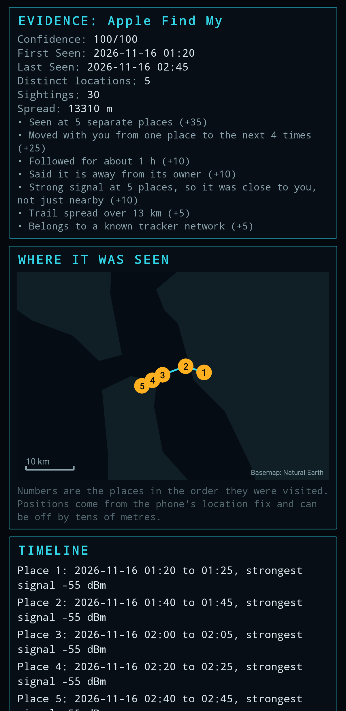
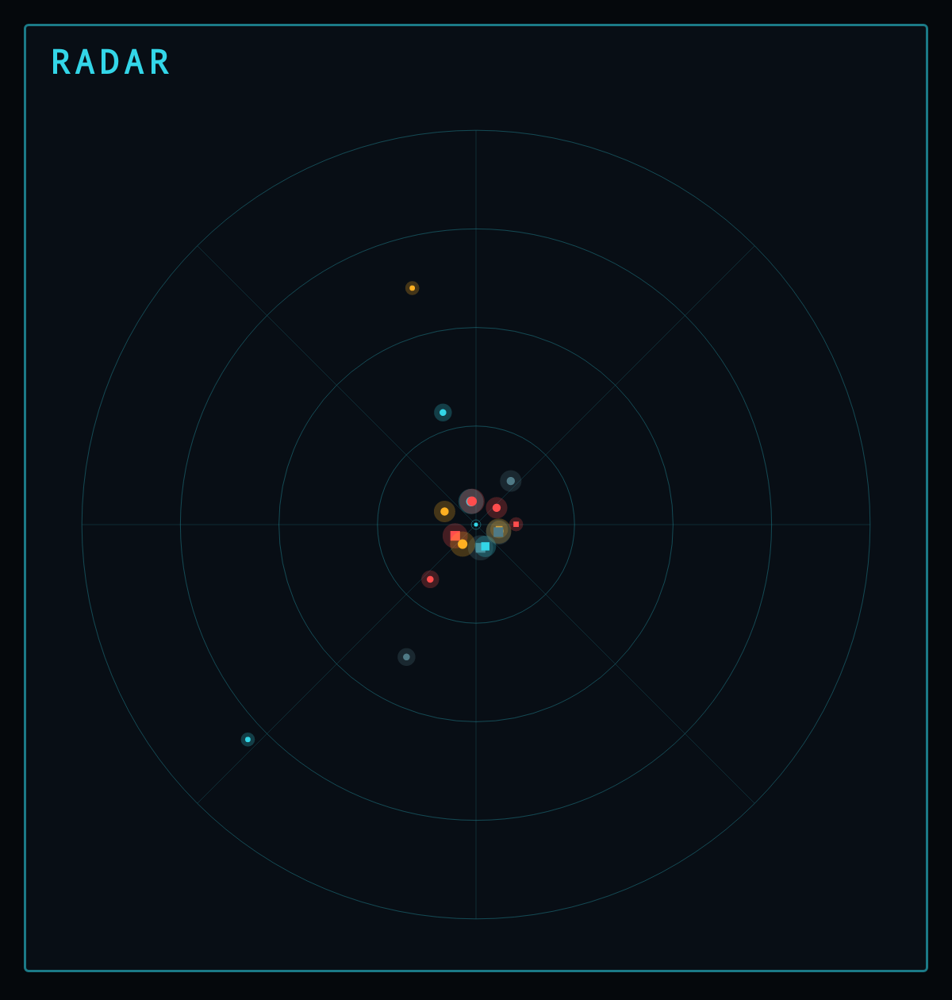
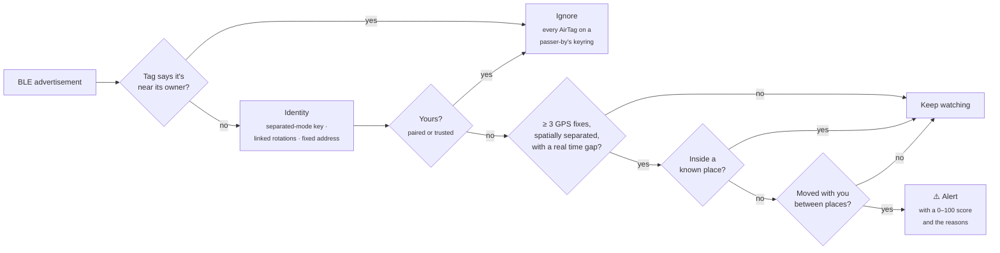

<p align="center">
  
</p>

<p align="center">
  <picture>
    <source media="(prefers-color-scheme: dark)" srcset="docs/banner-dark.svg">
    <source media="(prefers-color-scheme: light)" srcset="docs/banner-light.svg">
    
  </picture>
</p>

<h3 align="center">Know when a Bluetooth tracker is following you. Fully offline, open source, no Google required.</h3>

<p align="center">
  <a href="https://github.com/aubergine-ux/ambit/actions/workflows/ci.yml"></a>
  <a href="https://github.com/aubergine-ux/ambit/releases"></a>
  <a href="LICENSE"></a>
  
  
  
  
  <!-- Enable once the listings exist:
  <a href="https://f-droid.org/packages/io.aubergine.ambit/"></a>
  <a href="https://apt.izzysoft.de/fdroid/index/apk/io.aubergine.ambit"></a>
  <a href="https://hosted.weblate.org/engage/ambit/"></a>
  -->
</p>

<p align="center">
  <a href="https://github.com/aubergine-ux/ambit/releases/latest"></a>
  <!-- Enable once the listings exist:
  <a href="https://f-droid.org/packages/io.aubergine.ambit/"></a>
  <a href="https://apt.izzysoft.de/fdroid/index/apk/io.aubergine.ambit"></a>
  -->
</p>

<table align="center">
<tr>
<td align="center"><br><sub><b>Alert, with the reasons</b></sub></td>
<td align="center"><br><sub><b>Locate mode</b></sub></td>
<td align="center"><br><sub><b>Evidence and map</b></sub></td>
<td align="center"><br><sub><b>Radar</b></sub></td>
</tr>
</table>

<p align="center">
  <a href="#-features">Features</a> ·
  <a href="#-how-tracker-detection-works">How it works</a> ·
  <a href="#-how-ambit-compares">Compared</a> ·
  <a href="#-what-ambit-is-not">Limits</a> ·
  <a href="#-build">Build</a> ·
  <a href="#-roadmap">Roadmap</a>
</p>

---

> [!IMPORTANT]
> **Everything stays on your phone.** The manifest doesn't declare the `INTERNET` permission, so
> Android itself blocks Ambit from opening a connection. There are no accounts, no analytics,
> no telemetry and no cloud.

> [!CAUTION]
> **If you think you are in danger, contact your local emergency number.** Ambit is a tool for
> noticing trackers. It isn't a substitute for help from people. The app's offline Help page
> explains how to find support and keep evidence.

## ✦ Features

<table>
<tr>
<td width="50%" valign="top">

### 📡 Passive scanning
Wi-Fi access points and BLE advertisements are logged with signal strength, a timestamp and a
GPS fix. A foreground service keeps logging while the screen is off, so you can walk a building
with the phone in your pocket.

</td>
<td width="50%" valign="top">

### 🏷️ Vendor lookup
A bundled copy of the IEEE MA-L registry (about 40,000 assignments) names the manufacturer
behind real hardware addresses. Randomized BLE addresses are labeled *randomized*. Ambit
doesn't make up an "unknown device".

</td>
</tr>
<tr>
<td valign="top">

### 🛰️ Tracker detection
Ambit reads each tag's own "away from owner" state and follows AirTags, SmartTags, Find Hub
tags, Tiles and Chipolos through their address rotations. It runs in the background with the
screen off, and alerts only after a tag has been seen at **three separate places**.

</td>
<td valign="top">

### 📄 Evidence reports
Each alert has a map and a timeline, plus a **PDF report** written for police or a support
worker. It includes every sighting with local and UTC times, the method used and its limits,
and a SHA-256 fingerprint of the data. CSV, JSON, GPX, KML and a plain-text debrief are also
available. Files leave the phone only when you share them.

</td>
</tr>
<tr>
<td valign="top">

### 🔎 Locate mode
A hot/cold finder for a flagged tracker: a large signal meter, vibration and beeps that speed
up as the signal gets stronger, and **Play sound** for AirTags, Find My accessories and Find
Hub tags, but only after you confirm. Offline guides cover what each tracker looks like,
where they're usually hidden, and how to switch one off safely.

</td>
<td valign="top">

### 🛡️ Safety features
Lock the app with a PIN or your fingerprint. You can disguise its icon as "Notes", leave
instantly with a button or a shake, and keep alerts discreet on the lock screen. An offline
help page explains how to get support and keep evidence, without assuming which country
you're in.

</td>
</tr>
<tr>
<td valign="top">

### 🚌 Wi-Fi networks that follow you
Phone hotspots, car Wi-Fi and portable cameras are flagged when the same access point turns up
at three places you go, using the same rules as Bluetooth trackers. The alert says plainly that
it's often just someone on the same bus.

</td>
<td valign="top">

### 📷 Camera hints
Wi-Fi networks named like a camera or gadget in setup mode, hardware from camera makers, and
the Bluetooth IDs used by Meta and Luxottica camera glasses all get a note. There's also an
optional alert for glasses at close range. These are pattern matches, and the app labels them
that way.

</td>
</tr>
<tr>
<td valign="top">

### 🧭 Fewer false alarms
Your own paired headphones, watch and car never count. Tap **This is mine** to trust a tag,
and mark home or work as known places. A tag also has to *move with you* from place to place,
not just turn up where you happen to be twice. Every alert comes with a 0–100 score and a
plain-language list of why it was flagged.

</td>
<td valign="top">

### 🗺️ Offline maps
Sightings are drawn on a bundled world outline (Natural Earth). For street detail, import
your own MBTiles file. No map tiles are ever fetched.

</td>
</tr>
<tr>
<td valign="top">

### ✈️ Everyday use
A home-screen widget and a Quick Settings tile show whether scanning is on and start it with
one tap. Travel mode raises sensitivity for a trip and lets you mark a hotel as known until
you get home. Alerts show up on a paired watch through normal notification mirroring,
with Locate and Evidence actions.

</td>
<td valign="top">

### 🔬 Expert view
A live log of every Bluetooth advertisement: manufacturer data, service UUIDs, service data and
flags, plus the identity and owner state Ambit read from each one. You can filter it and pause
it.

</td>
</tr>
<tr>
<td valign="top">

### 🔐 Encryption and backups
The log is encrypted with SQLCipher under a key held by the phone's keystore. Old sightings are
deleted automatically after a period you choose. You can back everything up to one
password-protected file, restore it on another phone, or wipe it all in one step.

</td>
<td valign="top">

### 🎯 Radar view
Shows each device at a rough distance worked out from signal strength (near, mid or far). A
phone can't tell which direction a signal comes from, so a device's position around the circle
has no meaning; it's fixed per device so dots don't jump around. The device list is the
accurate view.

</td>
</tr>
</table>

## ✦ Screens

| Screen | What it's for |
|---|---|
| **OPS** | Radar, live Wi-Fi readout, Bluetooth controls and one-tap exports in one scroll. |
| **ALERTS** | Tracker verdicts, plus the evidence and method behind each one. |
| **LOCATE** | Hot/cold signal meter with vibration and beeps, plus Play sound on supported trackers. |
| **EVIDENCE** | Map and timeline for an alert, and the PDF report. |
| **HELP** | Offline guidance on getting support, keeping evidence and checking your phone. |
| **PACKET LOG** | Raw advertisements as they arrive, for researchers. |
| **GUIDE** | Offline, per-family guide: what it looks like, where it hides, how to disable it safely. |
| **EXPORT** | Every export format, with a preview of the debrief. |
| **SETTINGS** | Sensitivity, known places, trusted devices, travel mode, safety, reliability and battery, backups. |
| **Device detail** | Opens from any row: identity, RSSI trace over time, sighting history. |

## ✦ How tracker detection works

Tracker networks rotate their addresses so that strangers can't follow *the owner*. They also
tell the world whether the tag is with its owner, because that's how the networks themselves
warn about unwanted tracking. Ambit reads that state and keys on what each tag holds steady
while it's away from its owner:



| Family | Recognized by | Owner state | Identity while separated |
|---|---|---|---|
| Apple Find My | Manufacturer data `0x004C`, type `0x12` | Full-key form = separated | Public key, held ~24 h |
| Samsung SmartTag | Service data `0xFD5A` | State bits in byte 0 | Privacy ID, rotations stitched by aging counter |
| Google Find Hub | Service data `0xFEAA`, frame `0x40`/`0x41` | `0x41` = separated | Ephemeral ID, held ~24 h |
| Tile | Service `0xFEED` | Not advertised | Fixed address |
| Chipolo | Company `0x08C3`, service `0xFE33`/`0xFE65` | Not advertised | Fixed address |
| Pebblebee | Service `0xFA25` | Not advertised | Fixed address |
| Any DULT tracker | Service data `0xFCB2` (IETF draft) | Near-owner bit | Address, held while separated |
| Wi-Fi network | BSSID, from Wi-Fi scans | — | BSSID (real hardware) |

Beacons that don't match a known family are still correlated by address. A beacon that rotates
its address without saying how can't build up places, so it can't cause a false alarm.
Vendors change these formats between firmware generations, so treat a family label as a best
guess.

**Travelling together.** A move from one place to the next only counts if the tag was heard
shortly before you left and shortly after you arrived (within 2 hours on Standard). A
colleague's tag that you pass at the office, the canteen and the gym on separate trips
doesn't qualify.

**Sensitivity.** *Relaxed*, *Standard* and *High* change how far apart the places must be
(400 / 250 / 150 m), how long the trail must last (45 / 20 / 10 min), and, for Relaxed only,
require a fourth place. Every level needs at least three.

> [!NOTE]
> **Why three places?** One sighting is noise, and two is usually coincidence. The
> three-location threshold is a deliberate trade-off against false alarms, because an alert
> that cries wolf teaches you to ignore the one that matters. `TrackerCorrelatorTest` asserts
> the threshold so it can't be lowered quietly.

## ✦ How Ambit compares

There are good tracker detectors already. This is how they differ, as of November 2026.

| | **Ambit** | [AirGuard](https://github.com/seemoo-lab/AirGuard) | [Tracker Detect](https://support.apple.com/en-us/119874) | [Android unknown tracker alerts](https://support.google.com/android/answer/13658562) |
|---|---|---|---|---|
| Trackers | Find My, SmartTag, Find Hub, Tile, Chipolo, Pebblebee, any DULT tag | Find My, SmartTag, Find Hub, Tile, Chipolo, Pebblebee | AirTag and Find My only | Find Hub tags, AirTags, headphones |
| Background scanning | ✅ | ✅ | ❌ manual only | ✅ |
| Locate by signal | ✅ | ✅ | not documented | ✅ Find Hub tags |
| Play sound | Find My, Find Hub, Pebblebee, DULT | Find My, Find Hub, Pebblebee | ✅ | ✅ |
| Wi-Fi awareness | ✅ | ❌ | ❌ | ❌ |
| Evidence export | PDF, GPX, KML, CSV, JSON | PDF, CSV | ❌ | ❌ |
| Works with no network | ✅ no `INTERNET` permission | detection yes; maps and opt-in study use the network | not documented | not documented |
| Needs Google Play Services | ❌ | ❌ | not documented | ✅ |
| Open source | ✅ Apache-2.0 | ✅ Apache-2.0 | ❌ | ❌ |

<sub>Sources: AirGuard source at commit d515c53 and its <a href="https://f-droid.org/packages/de.seemoo.at_tracking_detection/">F-Droid listing</a>, <a href="https://support.apple.com/en-us/119874">Apple support</a>, <a href="https://support.google.com/android/answer/13658562">Android help</a>. AirGuard is the closest open alternative and has years of research and real-world testing behind it. Ambit 3.0's tracker formats come from published specifications and still need checking against more real trackers.</sub>

## ✦ What Ambit is not

> [!WARNING]
> Ambit only sees devices that are **actively broadcasting**. Please don't rely on it for more
> than that.

- ❌ It **can't** find a camera that records to an SD card without transmitting. Camera notes
  are pattern matches on network names, maker IDs and Bluetooth IDs, not detections.
- ❌ It **can't** identify people or vehicles.
- ❌ It **doesn't** intercept traffic. It reads advertisement and beacon metadata only.
- ❌ It **can't** give a bearing. A phone has one antenna and no direction finding. Locate
  mode shows signal strength only: *warmer* or *colder*, never "3 m to the left".
- ❌ It **can't** make every tracker beep. Tile, SmartTag and Chipolo's own network don't let
  other people make their tags beep, and any tag stays silent while it's near its owner.
- ❌ A vendor label describes the **manufacturer**, not the owner or the purpose. A "fleet"
  cellular router might belong to a food truck.

## ✦ Design constraints

These four constraints shaped the app.

<details>
<summary><b>Wi-Fi scan throttling</b></summary>

<br>

On Android 9+, `WifiManager.startScan()` is limited to four calls every two minutes, and
foreground apps aren't exempt. Ambit refreshes at that slow, real rate and shows the actual age
of the last scan. It never re-emits cached results with fresh timestamps to look faster. When
`getScanResults()` keeps returning the same frozen set, which is the sign of throttling, Ambit
points you to the *Wi-Fi scan throttling* switch in Developer Options.

</details>

<details>
<summary><b>MAC randomization</b></summary>

<br>

Most BLE devices rotate their address, so vendor lookup fails for most BLE hits. That's expected,
not a bug. Vendor classification mostly works for Wi-Fi, because access-point BSSIDs are real
hardware addresses. For BLE, a device's identity is its `TrackerSignature`, never its address.

</details>

<details>
<summary><b>The radar shows distance, not direction</b></summary>

<br>

The phone has one antenna, no phased array and no bearing information. Indoors, RSSI-based
distance is off by several meters. Each blip's angle is a hash of its identifier, so it stays put
between frames instead of jumping around, which would look like movement. No detection logic
ever reads a screen position.

</details>

<details>
<summary><b>Battery and staying alive</b></summary>

<br>

Scanning follows what you're doing. While you're moving, Bluetooth scans continuously. When
you're still, it runs 30-second bursts every two minutes, and only 20 seconds every five minutes
at a known place. Battery Saver halves that again, and GPS slows down to match. The goal is
under 3% of the battery a day on Standard.

Phone makers' battery managers often kill background apps anyway. Ambit records a heartbeat,
notices when it has been stopped, restarts itself after a reboot, and tells you the exact
setting to change for your brand of phone.

</details>

<details>
<summary><b>Foreground service typing</b></summary>

<br>

Android 14+ needs declared foreground-service types that match granted runtime permissions,
and it kills the process at `startForeground()` if they don't match. Ambit declares `location`
and `connectedDevice`, and its start buttons stay disabled until the matching permission is
granted.

</details>

## ✦ Permissions

<details>
<summary><b>What each permission is for</b></summary>

<br>

| Permission | Why |
|---|---|
| `ACCESS_FINE_LOCATION` / `COARSE` | Android returns **no** scan results without it. It also geotags sightings for the correlator. |
| `ACCESS_WIFI_STATE` / `CHANGE_WIFI_STATE` | Read and request Wi-Fi scans. |
| `BLUETOOTH_SCAN` | Receive BLE advertisements. |
| `BLUETOOTH_CONNECT` | Play sound on a tracker (only after you confirm), and recognize your own paired devices. |
| `ACCESS_BACKGROUND_LOCATION` | Optional. Keeps positions coming when scanning restarts after a reboot. Requested from settings, never at first launch. |
| `FOREGROUND_SERVICE_*` | Keep logging with the screen off. |
| `RECEIVE_BOOT_COMPLETED` | Resume a session that was running before a restart. |
| `POST_NOTIFICATIONS` | The ongoing-session notification and tracker alerts. |
| `VIBRATE` | Locate mode's pulses. |

`BLUETOOTH_SCAN` is declared **without** `neverForLocation`. That flag would look better on a
privacy checklist, but it strips location out of BLE results, and location is what the correlator
runs on. The onboarding screen explains this in plain words.

</details>

## ✦ Build

Requirements: JDK 17+ and the Android SDK (API 36).

```bash
./gradlew assembleDebug     # → app/build/outputs/apk/debug/
./gradlew test              # JVM unit tests: correlator, signatures, OUI, path loss, exporters
./gradlew lint

adb install -r app/build/outputs/apk/debug/app-debug.apk
```

> [!TIP]
> **The emulator has no radios**, so every scan comes back empty there. Test on a real phone
> over wireless debugging (`adb pair` / `adb connect`) so you can walk around untethered while
> it logs.

<details>
<summary><b>Reproducible builds</b></summary>

<br>

Release builds leave out the version-control and dependency metadata blobs that would make two
builds of the same commit differ. To check a published APK, build the tagged commit with the
same JDK (Temurin 17) and compare everything except the signature, for example with
`apksigcopier compare`. Each GitHub release also ships the APK's SHA-256.

</details>

<details>
<summary><b>Signed release builds</b></summary>

<br>

Release signing reads from a `keystore.properties` file in the project root. The file is
gitignored and never committed:

```properties
storeFile=app/release.jks
storePassword=…
keyAlias=…
keyPassword=…
```

or from the environment variables `AMBIT_STORE_FILE`, `AMBIT_STORE_PASSWORD`, `AMBIT_KEY_ALIAS`
and `AMBIT_KEY_PASSWORD`. If neither is present, `./gradlew assembleRelease` produces an
unsigned APK.

</details>

## ✦ Architecture

<details>
<summary><b>Stack and layout</b></summary>

<br>

Kotlin · Jetpack Compose + Material 3 · Room + SQLCipher · Hilt · DataStore ·
kotlinx-serialization · platform `LocationManager` (no Google Play Services).

```text
io.aubergine.ambit/
├── scan/         Wi-Fi + BLE scanners, motion-aware scan policy, foreground service
├── analysis/     signature extraction, tracker correlator, confidence, sensitivity, hints
├── locate/       signal smoothing, target matching, GATT play sound
├── evidence/     evidence report model and PDF writer
├── map/          offline basemap, MBTiles reader, shared map renderer
├── data/         Room database (encrypted, real migrations), repositories
├── backup/       password-encrypted backup, restore, full wipe
├── reliability/  heartbeat, watchdog, boot restart, battery readings
├── security/     app lock, disguise, quick exit
├── export/       CSV, JSON, GPX, KML, debrief
├── widget/       home-screen widget and Quick Settings tile
└── ui/           Compose screens
```

- Composables only talk to the repository layer, never to DAOs or scanners directly.
- All timestamps are UTC epoch millis, formatted only for display.
- Room migrations go back to the first schema, and every one has a test.

</details>

## ✦ Roadmap

- [x] Wi-Fi and Bluetooth scanning, encrypted log, vendor lookup, exports
- [x] Tracker detection with owner state, confidence scores and trusted devices
- [x] Locate mode, play sound, offline guides, evidence reports, offline maps
- [x] Safety features, travel mode, widget, Quick Settings tile, packet log
- [x] Reproducible build settings, fastlane metadata, signed GitHub releases
- [x] English and Albanian
- [ ] Verify every tracker format against real hardware
- [ ] F-Droid and IzzyOnDroid listings
- [ ] Translations on Weblate
- [ ] A watch app that works without Google Play Services

## ✦ Contributing

Issues and pull requests are welcome; see [CONTRIBUTING.md](CONTRIBUTING.md). Real-world
captures of tracker advertisements are especially useful: the packet log under
Settings › Expert shows the raw bytes. To report a security problem, see
[SECURITY.md](SECURITY.md).

## ✦ License

[Apache License 2.0](LICENSE).

---

<p align="center">
  <sub>
    Vendor names from the <a href="https://standards.ieee.org/products-programs/regauth/">IEEE MA-L registry</a> ·
    detection research by the <a href="https://github.com/seemoo-lab/AirGuard">AirGuard</a> team at SEEMOO, TU Darmstadt ·
    tracker formats from the IETF <a href="https://datatracker.ietf.org/doc/draft-ietf-dult-accessory-protocol/">DULT</a> drafts ·
    maps from <a href="https://www.naturalearthdata.com/">Natural Earth</a> ·
    encryption by <a href="https://www.zetetic.net/sqlcipher/">SQLCipher</a>
  </sub>
  <br><br>
  <a href="https://github.com/aubergine-ux"></a>
</p>
